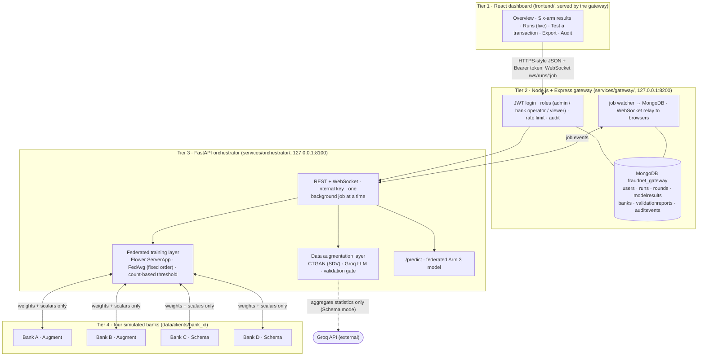

# FraudNet-Synth: Architecture

Four tiers on one laptop (CPU only, zero cost). Users only ever talk to Tier 2; Tier 3 listens on localhost only; each bank in Tier 4 reads only its own folder.

## What crosses each boundary
| Boundary | What travels | What never travels |
|---|---|---|
| Browser ↔ gateway | JSON, JWT (8 h), live round events | the internal key, any transaction row (except a bank operator exporting **their own** synthetic rows, D-045) |
| Gateway ↔ FastAPI | requests + `X-Internal-Key`; `X-Bank-Scope` taken from the token | user passwords |
| Bank ↔ federated server | 4,161 weights (17,478 B/round), row count, scalar metrics; after training 241 TP/FP count pairs and scalar local-test metrics | rows, per-transaction scores (checked by `tests/test_privacy_invariant.py`) |
| Schema-mode bank ↔ Groq | schema + mean, std, p10/p50/p90 per column (D-015/D-016) | real rows, min/max |
| Anything ↔ MongoDB | metrics, run metadata, audit events, bcrypt password hashes | transaction rows |

## Main flows
1. **Start a run:** dashboard → `POST /api/runs` (admin only) → `POST /runs` → job process runs Arms 1–6 (`ml.baselines.arms`, `ml.federated.run`) → events → gateway watcher → MongoDB + browsers.
2. **Generation:** `POST /api/generation` → replay (CTGAN retrained with its seed, LLM rows from cache, 0 API calls) or versioned regenerate → validation gate → `generations/` inside the bank folder.
3. **Predict:** dashboard form → gateway → `/predict` → fixed feature transforms → MLP logit vs threshold 3.75.
4. **Report:** `python -m ml.experiments.run_all_arms` (or a dashboard run) → `python -m ml.evaluation.annexure` → `docs/RESULTS_ANNEXURE.md`.

## Ports and processes
| Port | Process | Exposed to |
|---|---|---|
| 8200 | gateway + built dashboard | this laptop (browser) |
| 8100 | FastAPI orchestrator | localhost only (gateway) |
| 27017 | MongoDB (Windows service) | localhost |
| 9092 / 9093 | Flower SuperLink fleet / control (Step 8B demo only) | hotspot LAN / localhost |

## Key code
| Area | Path |
|---|---|
| Data, split, partition | `ml/data/` |
| Classifier, features, training | `ml/models/` (`FraudMLP` 31→64→32→1) |
| CTGAN / LLM generation | `ml/augmentation/ctgan_engine.py`, `llm_engine.py`, `schema_stats.py` |
| Validation gate | `ml/validation/` |
| Isolated + centralized arms | `ml/baselines/arms.py` |
| Federated (simulation + deployment) | `ml/federated/` (`client_app.py`, `server_app.py`, `run.py`, `demo/`) |
| Six-arm runner, report, annexure | `ml/experiments/run_all_arms.py`, `ml/evaluation/` |
| Services | `services/orchestrator/`, `services/gateway/` |
| Dashboard | `frontend/src/` |
| Offline demo | `demo/` (`preflight.py`, `start.py`, `viva_sheet.py`) |

All design choices and their reasons are in `docs/DECISIONS.md` (D-000 onwards).
