# FraudNet-Synth: Results Annexure

Generated 2026-10-12T09:14:22+00:00 by `python -m ml.evaluation.annexure --job 20261012-142636-run-eed13e` from real run outputs (git commit `ee02daf`). **No number below was typed by hand:** every table is rendered from the CSV/JSON named under it, every figure is copied byte-for-byte from the run that produced it, and every number in a caption is computed by the generator. SHA-256 checksums of all sources are in `results/final_annexure/provenance.json`.

The six-arm tables come from the **full run triggered from the dashboard** (job `20261012-142636-run-eed13e`, seeds [42, 43, 44, 45, 46], 2026-10-12T08:56:36+00:00 → 2026-10-12T09:11:25+00:00 UTC). Table A7 shows whether it is identical to the command-line Step 9 run: **True**.

7 tables and 12 figures.

## A. Data and non-IID partition

### Table A1. Dataset summary (ULB credit-card fraud)

| quantity | value |
|---|---|
| transactions | 284,807 |
| fraud / genuine | 492 / 284,315 |
| fraud rate | 0.1727% |
| accuracy of 'always genuine' | 99.8273% |
| missing values | 0 |
| exact duplicate rows (dropped, D-005) | 1081 |
| time span (hours) | 48.0 |

*Source: `results/eda/eda_summary.json` · CSV: `results/final_annexure/tables/T01_dataset_summary.csv`*

### Figure A1. Class balance

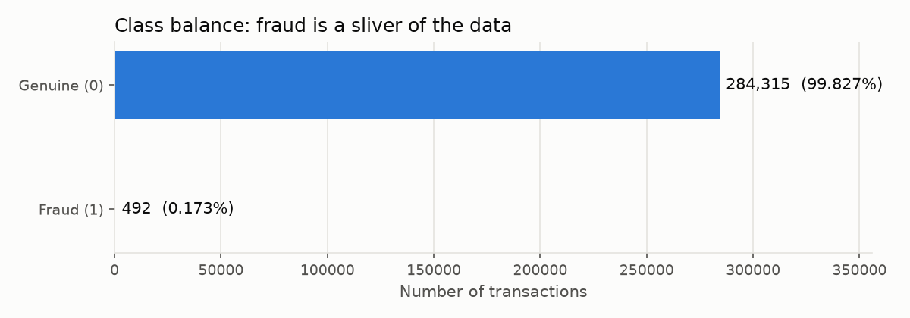

Fraud is 0.17% of transactions, which is why accuracy is not a headline metric.

*Source: `results/eda/class_balance.png`*

### Table A2. Global split and bank shards

| set | part | rows | fraud | genuine | fraud_pct |
|---|---|---|---|---|---|
| global | train | 198607 | 331 | 198276 | 0.1667 |
| global | val | 28373 | 47 | 28326 | 0.1657 |
| global | test | 56746 | 95 | 56651 | 0.1674 |
| bank_a | shard | 69546 | 149 | 69397 | 0.2142 |
| bank_a | train | 48682 | 105 | 48577 | 0.2157 |
| bank_a | val | 10432 | 22 | 10410 | 0.2109 |
| bank_a | test | 10432 | 22 | 10410 | 0.2109 |
| bank_b | shard | 59599 | 116 | 59483 | 0.1946 |
| bank_b | train | 41719 | 82 | 41637 | 0.1966 |
| bank_b | val | 8940 | 17 | 8923 | 0.1902 |
| bank_b | test | 8940 | 17 | 8923 | 0.1902 |
| bank_c | shard | 39695 | 40 | 39655 | 0.1008 |
| bank_c | train | 27785 | 28 | 27757 | 0.1008 |
| bank_c | val | 5955 | 6 | 5949 | 0.1008 |
| bank_c | test | 5955 | 6 | 5949 | 0.1008 |
| bank_d | shard | 29767 | 26 | 29741 | 0.0873 |
| bank_d | train | 20836 | 18 | 20818 | 0.0864 |
| bank_d | val | 4465 | 4 | 4461 | 0.0896 |
| bank_d | test | 4466 | 4 | 4462 | 0.0896 |

*Source: `results/partition/shard_stats.csv` · CSV: `results/final_annexure/tables/T02_split_and_shards.csv`*

### Figure A2. Non-IID partition: fraud rows and fraud rate per bank

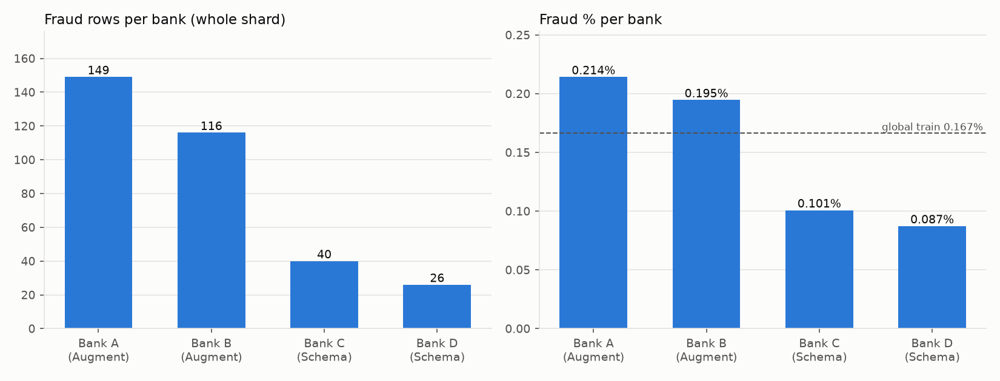

Explicit quotas (D-007): fraud rows A 149, B 116, C 40, D 26. Banks A and B use Augment mode (CTGAN); Banks C and D use Schema mode (LLM).

*Source: `results/partition/shard_stats.png`*

## B. Synthetic data: generation and validation

### Table A3. Synthetic generation and validation gate, per bank

| bank | mode | real train fraud | candidates | mean KS (lower = closer) | mean \|corr diff\| | validated | pass rate % | fidelity validated | too close to real (privacy) | patterned decimals % (report-only) |
|---|---|---|---|---|---|---|---|---|---|---|
| bank_a | Augment (CTGAN) | 105 | 1000 | 0.219 | 0.148 | 868 | 86.8 | 0.8041 | 0 | 1.5 |
| bank_b | Augment (CTGAN) | 82 | 1000 | 0.223 | 0.153 | 814 | 81.4 | 0.8002 | 0 | 1.7 |
| bank_c | Schema (LLM) | 28 | 300 | 0.26 | 0.493 | 234 | 78.0 | 0.7461 | 0 | 68.9 |
| bank_d | Schema (LLM) | 18 | 300 | 0.252 | 0.493 | 264 | 88.0 | 0.7559 | 0 | 63.6 |

*Source: `results/validation/validation_summary.csv`, `results/ctgan/bank_a_summary.json`, `results/validation/bank_a_report.json`, `results/ctgan/bank_b_summary.json`, `results/validation/bank_b_report.json`, `results/llm/bank_c_summary.json`, `results/validation/bank_c_report.json`, `results/llm/bank_d_summary.json`, `results/validation/bank_d_report.json` · CSV: `results/final_annexure/tables/T03_synthetic_and_gate.csv`*

### Figure A3. Augment mode: Bank A real fraud vs CTGAN candidates

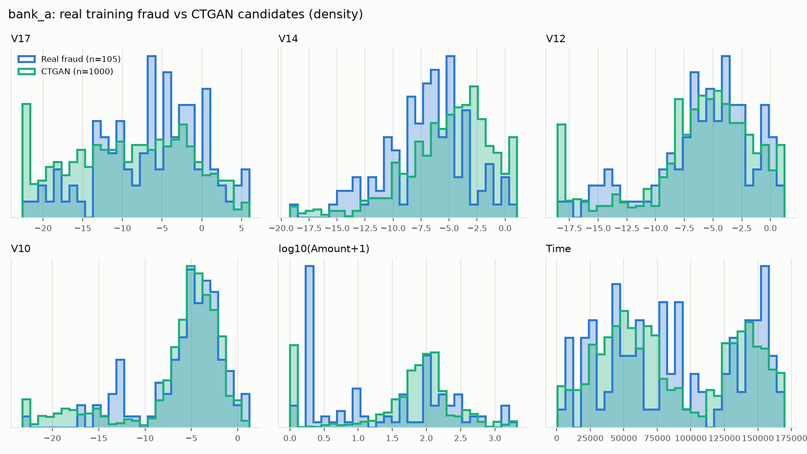

CTGAN keeps the broad shape of real fraud; spikes at the range edges come from SDV's min/max clamping.

*Source: `results/ctgan/bank_a_real_vs_synthetic.png`*

### Figure A4. Schema mode: Bank C real fraud vs LLM candidates

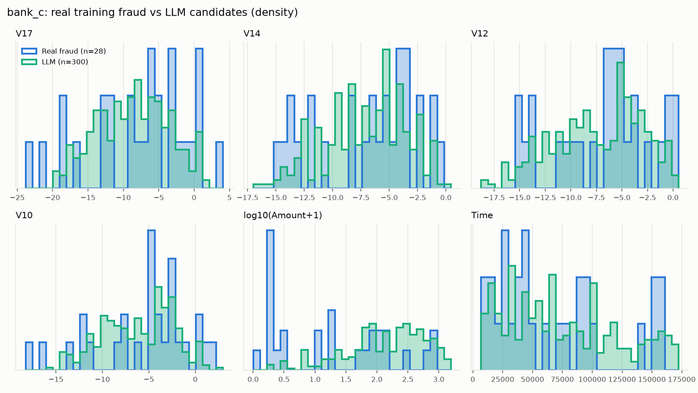

The LLM received only aggregate statistics (no real rows). Mean |correlation difference| 0.493 vs 0.148 for CTGAN (Bank A).

*Source: `results/llm/bank_c_real_vs_synthetic.png`*

### Figure A5. Validation gate outcome per bank

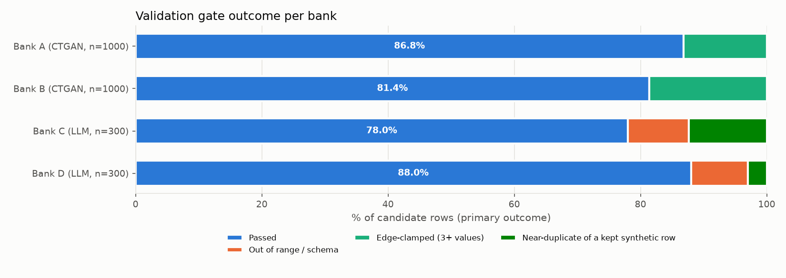

Same rules for both modes; 0 synthetic rows were rejected as near-copies of a real row.

*Source: `results/validation/gate_outcomes.png`*

## C. Six-arm results (full run triggered from the dashboard, job `20261012-142636-run-eed13e`, seeds [42, 43, 44, 45, 46])

### Table A4. Six-arm comparison on the global test set (95 frauds), mean ± std over seeds

| arm | setting | model | precision | recall | f1 | pr_auc | roc_auc | accuracy |
|---|---|---|---|---|---|---|---|---|
| 1 | Isolated, real | bank_a | 0.8551 ± 0.0131 | 0.7684 ± 0.0129 | 0.8093 ± 0.0048 | 0.7045 ± 0.0064 | 0.9593 ± 0.0052 | 0.9994 ± 0.0000 |
| 1 | Isolated, real | bank_b | 0.8936 ± 0.0012 | 0.7074 ± 0.0088 | 0.7896 ± 0.0060 | 0.7150 ± 0.0044 | 0.9574 ± 0.0042 | 0.9994 ± 0.0000 |
| 1 | Isolated, real | bank_c | 0.8661 ± 0.0125 | 0.5853 ± 0.0231 | 0.6983 ± 0.0181 | 0.7020 ± 0.0068 | 0.9367 ± 0.0039 | 0.9992 ± 0.0000 |
| 1 | Isolated, real | bank_d | 0.7994 ± 0.0103 | 0.3200 ± 0.0346 | 0.4563 ± 0.0366 | 0.6617 ± 0.0161 | 0.9368 ± 0.0046 | 0.9987 ± 0.0001 |
| 1 | Isolated, real | average of 4 banks | 0.8535 ± 0.0042 | 0.5953 ± 0.0092 | 0.6884 ± 0.0109 | 0.6958 ± 0.0068 | 0.9476 ± 0.0035 | 0.9992 ± 0.0000 |
| 2 | Isolated, augmented | bank_a | 0.8179 ± 0.0405 | 0.7747 ± 0.0094 | 0.7952 ± 0.0154 | 0.7041 ± 0.0036 | 0.9566 ± 0.0030 | 0.9993 ± 0.0001 |
| 2 | Isolated, augmented | bank_b | 0.8939 ± 0.0025 | 0.7095 ± 0.0191 | 0.7910 ± 0.0129 | 0.7164 ± 0.0095 | 0.9583 ± 0.0034 | 0.9994 ± 0.0000 |
| 2 | Isolated, augmented | bank_c | 0.8710 ± 0.0057 | 0.5832 ± 0.0294 | 0.6983 ± 0.0221 | 0.7012 ± 0.0082 | 0.9353 ± 0.0031 | 0.9992 ± 0.0000 |
| 2 | Isolated, augmented | bank_d | 0.8107 ± 0.0117 | 0.3621 ± 0.0274 | 0.5003 ± 0.0285 | 0.6511 ± 0.0203 | 0.9320 ± 0.0063 | 0.9988 ± 0.0000 |
| 2 | Isolated, augmented | average of 4 banks | 0.8484 ± 0.0100 | 0.6074 ± 0.0084 | 0.6962 ± 0.0095 | 0.6932 ± 0.0077 | 0.9455 ± 0.0024 | 0.9992 ± 0.0000 |
| 3 | Federated, real | federated | 0.8376 ± 0.0357 | 0.7600 ± 0.0216 | 0.7961 ± 0.0063 | 0.7158 ± 0.0061 | 0.9625 ± 0.0038 | 0.9993 ± 0.0000 |
| 4 | Federated, augmented | federated | 0.8451 ± 0.0464 | 0.7558 ± 0.0115 | 0.7973 ± 0.0165 | 0.7171 ± 0.0067 | 0.9623 ± 0.0036 | 0.9994 ± 0.0001 |
| 5 | Centralized, real | centralized | 0.8905 ± 0.0058 | 0.6863 ± 0.0390 | 0.7748 ± 0.0275 | 0.7267 ± 0.0037 | 0.9672 ± 0.0046 | 0.9993 ± 0.0001 |
| 6 | Centralized, augmented | centralized | 0.8536 ± 0.0453 | 0.7074 ± 0.0738 | 0.7701 ± 0.0312 | 0.7250 ± 0.0061 | 0.9644 ± 0.0032 | 0.9993 ± 0.0001 |

*Source: `results/api_jobs/20261012-142636-run-eed13e/six_arm_global_table.csv` (headline: precision, recall, F1, PR-AUC; ROC-AUC and accuracy secondary) · CSV: `results/final_annexure/tables/T04_six_arm_global.csv`*

### Table A5. Each bank's local test set, all six arms

| local_test_of | arm | setting | f1 | pr_auc | recall | frauds_caught_per_seed |
|---|---|---|---|---|---|---|
| bank_a | 1 | Isolated, real | 0.7964 ± 0.0241 | 0.7395 ± 0.0146 | 0.7818 ± 0.0203 | 17/18/17/17/17 |
| bank_a | 2 | Isolated, augmented | 0.8088 ± 0.0277 | 0.7449 ± 0.0073 | 0.8091 ± 0.0380 | 17/18/19/17/18 |
| bank_a | 3 | Federated, real | 0.8408 ± 0.0143 | 0.7546 ± 0.0033 | 0.8182 ± 0.0455 | 17/18/19/17/19 |
| bank_a | 4 | Federated, augmented | 0.8058 ± 0.0173 | 0.7437 ± 0.0074 | 0.7727 ± 0.0321 | 17/16/17/17/18 |
| bank_a | 5 | Centralized, real | 0.7225 ± 0.0391 | 0.7299 ± 0.0271 | 0.6182 ± 0.0518 | 13/12/15/14/14 |
| bank_a | 6 | Centralized, augmented | 0.7394 ± 0.0591 | 0.7347 ± 0.0103 | 0.6727 ± 0.1177 | 12/13/14/17/18 |
| bank_b | 1 | Isolated, real | 0.7040 ± 0.0308 | 0.5886 ± 0.0332 | 0.7294 ± 0.0526 | 12/12/12/12/14 |
| bank_b | 2 | Isolated, augmented | 0.6820 ± 0.0214 | 0.6134 ± 0.0593 | 0.6941 ± 0.0263 | 11/12/12/12/12 |
| bank_b | 3 | Federated, real | 0.7656 ± 0.0165 | 0.6027 ± 0.0420 | 0.8824 ± 0.0000 | 15/15/15/15/15 |
| bank_b | 4 | Federated, augmented | 0.7854 ± 0.0091 | 0.6080 ± 0.0188 | 0.8824 ± 0.0000 | 15/15/15/15/15 |
| bank_b | 5 | Centralized, real | 0.6862 ± 0.0196 | 0.6330 ± 0.0411 | 0.6824 ± 0.0322 | 11/11/12/12/12 |
| bank_b | 6 | Centralized, augmented | 0.7386 ± 0.0482 | 0.6290 ± 0.0393 | 0.7882 ± 0.0892 | 12/12/13/15/15 |
| bank_c | 1 | Isolated, real | 0.8436 ± 0.0598 | 0.9332 ± 0.0472 | 0.7333 ± 0.0913 | 4/5/5/4/4 |
| bank_c | 2 | Isolated, augmented | 0.8388 ± 0.1072 | 0.9353 ± 0.0517 | 0.7333 ± 0.1491 | 5/5/4/3/5 |
| bank_c | 3 | Federated, real | 0.8312 ± 0.1040 | 0.9867 ± 0.0298 | 0.9333 ± 0.0913 | 5/6/6/6/5 |
| bank_c | 4 | Federated, augmented | 0.8697 ± 0.0715 | 1.0000 ± 0.0000 | 0.9333 ± 0.0913 | 6/5/5/6/6 |
| bank_c | 5 | Centralized, real | 0.8655 ± 0.0598 | 1.0000 ± 0.0000 | 0.7667 ± 0.0913 | 5/5/5/4/4 |
| bank_c | 6 | Centralized, augmented | 0.8929 ± 0.0524 | 1.0000 ± 0.0000 | 0.8667 ± 0.1394 | 4/5/5/6/6 |
| bank_d | 1 | Isolated, real | 0.0000 ± 0.0000 | 0.4889 ± 0.0036 | 0.0000 ± 0.0000 | 0/0/0/0/0 |
| bank_d | 2 | Isolated, augmented | 0.0000 ± 0.0000 | 0.4872 ± 0.0060 | 0.0000 ± 0.0000 | 0/0/0/0/0 |
| bank_d | 3 | Federated, real | 0.7500 ± 0.0000 | 0.6280 ± 0.0179 | 0.7500 ± 0.0000 | 3/3/3/3/3 |
| bank_d | 4 | Federated, augmented | 0.7000 ± 0.0456 | 0.6085 ± 0.0136 | 0.7500 ± 0.0000 | 3/3/3/3/3 |
| bank_d | 5 | Centralized, real | 0.6429 ± 0.0978 | 0.6129 ± 0.0140 | 0.6000 ± 0.1369 | 3/2/3/2/2 |
| bank_d | 6 | Centralized, augmented | 0.6243 ± 0.1843 | 0.6225 ± 0.0241 | 0.6500 ± 0.2850 | 1/3/2/4/3 |

*Source: `results/api_jobs/20261012-142636-run-eed13e/local_test_table.csv` · CSV: `results/final_annexure/tables/T05_local_tests.csv`*

### Table A6. Paired comparisons on the global test set (95% CI)

| family | comparison | bank | metric | mean diff | 95% CI | seeds up | verdict |
|---|---|---|---|---|---|---|---|
| augmentation | Arm 2 - Arm 1 | bank_a | f1 | -0.0141 | [-0.0386, +0.0103] | 2/5 | no clear difference |
| augmentation | Arm 2 - Arm 1 | bank_a | pr_auc | -0.0004 | [-0.0077, +0.0069] | 2/5 | no clear difference |
| federation | Arm 3 - Arm 1 | bank_a | f1 | -0.0132 | [-0.0203, -0.0060] | 0/5 | lower |
| federation | Arm 3 - Arm 1 | bank_a | pr_auc | +0.0113 | [+0.0044, +0.0181] | 5/5 | higher |
| augmentation | Arm 2 - Arm 1 | bank_b | f1 | +0.0013 | [-0.0143, +0.0170] | 2/5 | no clear difference |
| augmentation | Arm 2 - Arm 1 | bank_b | pr_auc | +0.0013 | [-0.0096, +0.0123] | 2/5 | no clear difference |
| federation | Arm 3 - Arm 1 | bank_b | f1 | +0.0065 | [-0.0069, +0.0199] | 4/5 | no clear difference |
| federation | Arm 3 - Arm 1 | bank_b | pr_auc | +0.0008 | [-0.0092, +0.0108] | 3/5 | no clear difference |
| augmentation | Arm 2 - Arm 1 | bank_c | f1 | -0.0000 | [-0.0226, +0.0226] | 2/5 | no clear difference |
| augmentation | Arm 2 - Arm 1 | bank_c | pr_auc | -0.0008 | [-0.0095, +0.0079] | 1/5 | no clear difference |
| federation | Arm 3 - Arm 1 | bank_c | f1 | +0.0978 | [+0.0768, +0.1189] | 5/5 | higher |
| federation | Arm 3 - Arm 1 | bank_c | pr_auc | +0.0138 | [+0.0075, +0.0201] | 5/5 | higher |
| augmentation | Arm 2 - Arm 1 | bank_d | f1 | +0.0440 | [-0.0072, +0.0951] | 4/5 | no clear difference |
| augmentation | Arm 2 - Arm 1 | bank_d | pr_auc | -0.0106 | [-0.0320, +0.0108] | 1/5 | no clear difference |
| federation | Arm 3 - Arm 1 | bank_d | f1 | +0.3398 | [+0.2986, +0.3811] | 5/5 | higher |
| federation | Arm 3 - Arm 1 | bank_d | pr_auc | +0.0541 | [+0.0378, +0.0705] | 5/5 | higher |
| augmentation | Arm 4 - Arm 3 | all banks | f1 | +0.0011 | [-0.0202, +0.0225] | 2/5 | no clear difference |
| augmentation | Arm 4 - Arm 3 | all banks | pr_auc | +0.0012 | [-0.0077, +0.0102] | 2/5 | no clear difference |
| augmentation | Arm 6 - Arm 5 | all banks | f1 | -0.0047 | [-0.0485, +0.0392] | 3/5 | no clear difference |
| augmentation | Arm 6 - Arm 5 | all banks | pr_auc | -0.0017 | [-0.0080, +0.0045] | 2/5 | no clear difference |
| fed_vs_central | Arm 3 - Arm 5 | all banks | f1 | +0.0214 | [-0.0169, +0.0596] | 4/5 | no clear difference |
| fed_vs_central | Arm 3 - Arm 5 | all banks | pr_auc | -0.0109 | [-0.0207, -0.0010] | 1/5 | lower |
| fed_vs_central | Arm 4 - Arm 6 | all banks | f1 | +0.0271 | [-0.0074, +0.0616] | 3/5 | no clear difference |
| fed_vs_central | Arm 4 - Arm 6 | all banks | pr_auc | -0.0079 | [-0.0208, +0.0050] | 1/5 | no clear difference |

*Source: `results/api_jobs/20261012-142636-run-eed13e/paired_comparisons.csv` (all 56 F1/PR-AUC comparisons incl. local tests are in the CSV) · CSV: `results/final_annexure/tables/T06_paired_global.csv`*

### Figure A6. Fraud F1 and PR-AUC by arm (mean ± std)

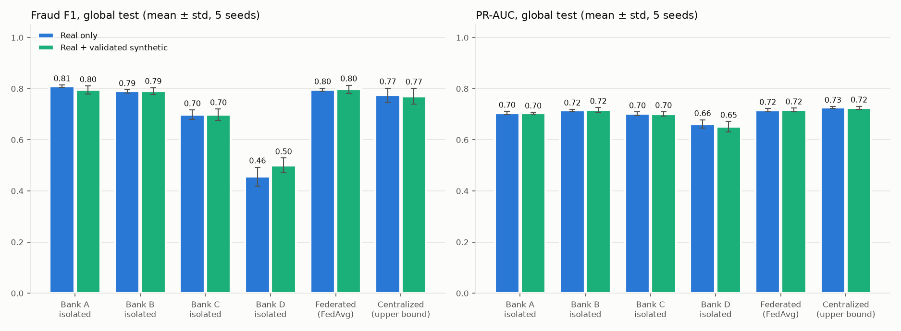

Blue = real data only, aqua = real + validated synthetic. Error bars = std over seeds.

*Source: `results/api_jobs/20261012-142636-run-eed13e/six_arm_f1_prauc.png`*

### Figure A7. Paired differences with 95% confidence intervals

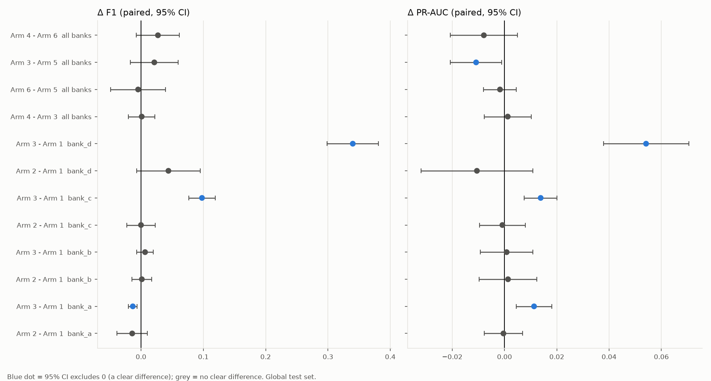

Blue = the interval excludes 0 (a clear difference). Augmentation: 33 of 36 comparisons show no clear difference.

*Source: `results/api_jobs/20261012-142636-run-eed13e/paired_deltas.png`*

### Figure A8. Federated convergence (global PR-AUC per round, mean ± std)

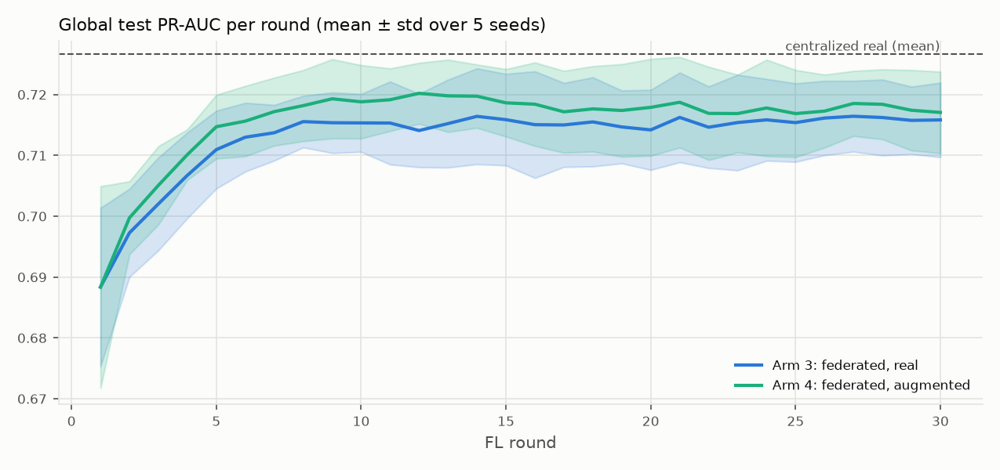

Arm 3 mean global PR-AUC: round 1 0.6884, round 10 0.7153, round 30 0.7158. The y-axis is zoomed.

*Source: `results/api_jobs/20261012-142636-run-eed13e/convergence_seeds.png`*

### Figure A9. Per-bank view of one federated run (Arm 3, seed 42)

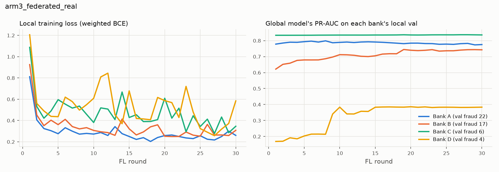

The global model's PR-AUC on Bank D's own validation set: round 1 0.1691, round 30 0.3836.

*Source: `results/federated/convergence_per_bank_arm3_federated_real.png`*

## D. Integration evidence

### Table A7. Dashboard run vs command-line run (Step 9): identical?

| metric | max \|difference\| |
|---|---|
| precision | 0.0 |
| recall | 0.0 |
| f1 | 0.0 |
| pr_auc | 0.0 |
| roc_auc | 0.0 |
| accuracy | 0.0 |
| tp | 0.0 |
| fp | 0.0 |
| fn | 0.0 |
| rows compared (dashboard / CLI / unmatched) | 180 / 180 / 0 |

*Source: `results/api_jobs/20261012-142636-run-eed13e/long_results.csv`, `results/six_arms/long_results.csv` (identical = True) · CSV: `results/final_annexure/tables/T07_dashboard_vs_cli.csv`*

### Figure A10. The full run in the dashboard, finished

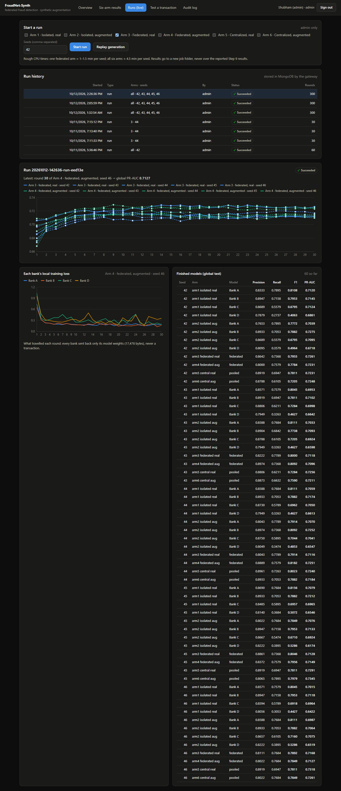

Started from the browser as admin (job 20261012-142636-run-eed13e): all six arms, seeds [42, 43, 44, 45, 46], live federated rounds.

*Source: `results/integration/04_full_run_finished.png`*

### Figure A11. Six-arm results page (dashboard, light theme)

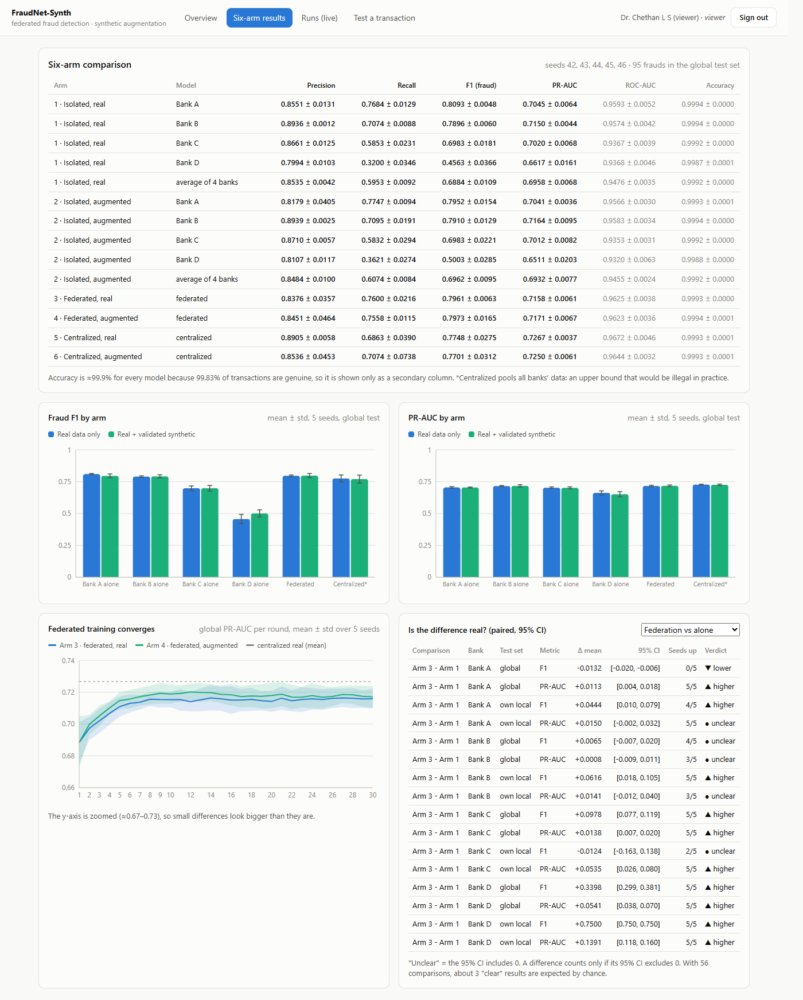

Headline fraud-class metrics in bold; accuracy and ROC-AUC greyed as secondary.

*Source: `results/dashboard_demo/02b_six_arm_results_light.png`*

### Figure A12. Test-a-transaction page

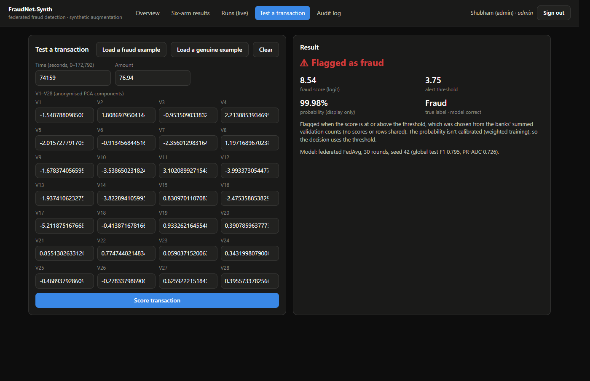

The federated Arm 3 model (decision threshold logit 3.75) scores a real fraud example from the global test set.

*Source: `results/dashboard_demo/05_predict_fraud_example.png`*
