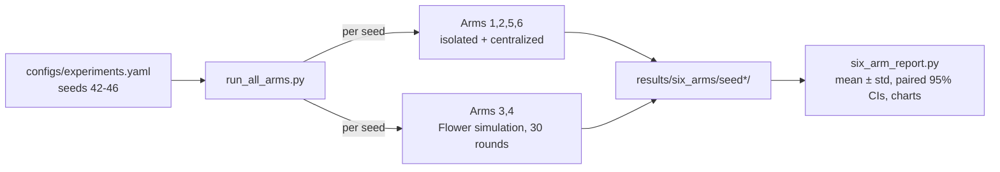

# Step 9: Six-Arm Experiment Runner and Results (Phase 4 → Phase 7 prep)

## 1. Goal
Run **all six experimental arms from one command**, repeat them over **5 seeds**, and report every headline metric as **mean ± standard deviation**. Every claimed difference between arms is backed by a **paired difference with a 95% confidence interval**. This turns the single-seed hints of Steps 7–8 into evidence, and it meets the report's **Phase 4 exit criterion: all six arms runnable end-to-end from the command line**. It also gives an honest answer to our two research questions: *does federation help?* and *does validated synthetic augmentation help, per bank?*

## 2. Concepts explained simply
- **Seed:** the starting number for the computer's "dice". A seed changes the model's initial weights, the order of training batches, the FL clients' randomness and which validated synthetic rows are sampled. **It does not change the data:** the split, the bank shards, the CTGAN/LLM pools and the validation gate are fixed (D-038).
- **Mean ± standard deviation:** we judge a batsman by his average over several innings, plus how much his scores vary, not by one innings. Five seeds = five innings.
- **Paired difference:** for each seed, compare two arms that used *the same seed* (e.g. augmented minus real-only). Luck shared by both cancels out, so small real effects become visible. **Analogy:** testing two shoes by having the *same* runner run in each, rather than two different runners.
- **95% confidence interval (CI):** a range that very likely contains the true average difference. **If the CI includes 0, we cannot claim any effect.** With 5 seeds, CI = mean ± 2.776 × std / √5.
- **Multiple comparisons:** we made 56 headline comparisons (F1 and PR-AUC). At 95% confidence, about **3 "clear" results would appear by pure chance**. So a few isolated "clear" results mean little; a consistent pattern means a lot.

## 3. What we built
| File | What it does |
|---|---|
| `configs/experiments.yaml` (`six_arms`) | Seeds 42–46, confidence 0.95, results folder |
| `ml/experiments/run_all_arms.py` | **One command**: for each seed runs Arms 1, 2, 5, 6 (`ml.baselines.arms.run`) and Arms 3, 4 (Flower simulation, 30 rounds); resumes from saved files; then builds the report |
| `ml/evaluation/six_arm_report.py` | Loads all seeds into one long table; the six-arm global table, local-test table, paired comparisons with t-based CIs, and three charts |
| `ml/federated/server_app.py` (small change) | `FRAUDNET_FL_OUT_DIR` lets the runner keep federated results per seed, without touching Step 8's files |
| `tests/test_six_arm_stats.py` | 4 tests: the CI matches the textbook formula; a CI crossing 0 → "no clear difference"; consistently worse → "lower"; pairing detects a small consistent effect |



## 4. How to run it
```powershell
.venv\Scripts\activate
python -m ml.experiments.run_all_arms                 # ~22 min on CPU for 5 seeds; resumes if interrupted
python -m ml.experiments.run_all_arms --report-only   # rebuild tables/charts from saved results
```

## 5. Evidence (real output, seeds 42–46, 2026-10-11)
Full output: `results/six_arms/console_run.txt`. Tables: `six_arm_global_table.csv`, `local_test_table.csv`, `paired_comparisons.csv`, `long_results.csv`. Charts: `six_arm_f1_prauc.png`, `paired_deltas.png`, `convergence_seeds.png`. Run time: **1,311 s** for all six arms × 5 seeds.

**Reproducibility check:** seed 42 reproduced Step 7 (Arms 1, 2, 5, 6) and Step 8 (Arms 3, 4) **exactly**.

### 5.1 Six-arm table: global test set (95 frauds), mean ± std over 5 seeds
Headline: precision, recall, F1, PR-AUC. ROC-AUC and accuracy are secondary.

| Arm | Model | Precision | Recall | **F1** | **PR-AUC** | ROC-AUC | Accuracy |
|---|---|---|---|---|---|---|---|
| 1 Isolated, real | Bank A | 0.8551 ± 0.0131 | 0.7684 ± 0.0129 | **0.8093 ± 0.0048** | **0.7045 ± 0.0064** | 0.9593 ± 0.0052 | 0.9994 |
| | Bank B | 0.8936 ± 0.0012 | 0.7074 ± 0.0088 | **0.7896 ± 0.0060** | **0.7150 ± 0.0044** | 0.9574 ± 0.0042 | 0.9994 |
| | Bank C | 0.8661 ± 0.0125 | 0.5853 ± 0.0231 | **0.6983 ± 0.0181** | **0.7020 ± 0.0068** | 0.9367 ± 0.0039 | 0.9992 |
| | Bank D | 0.7994 ± 0.0103 | 0.3200 ± 0.0346 | **0.4563 ± 0.0366** | **0.6617 ± 0.0161** | 0.9368 ± 0.0046 | 0.9987 |
| | *average of 4 banks* | 0.8535 ± 0.0042 | 0.5953 ± 0.0092 | **0.6884 ± 0.0109** | **0.6958 ± 0.0068** | 0.9476 ± 0.0035 | 0.9992 |
| 2 Isolated, augmented | Bank A | 0.8179 ± 0.0405 | 0.7747 ± 0.0094 | **0.7952 ± 0.0154** | **0.7041 ± 0.0036** | 0.9566 ± 0.0030 | 0.9993 |
| | Bank B | 0.8939 ± 0.0025 | 0.7095 ± 0.0191 | **0.7910 ± 0.0129** | **0.7164 ± 0.0095** | 0.9583 ± 0.0034 | 0.9994 |
| | Bank C | 0.8710 ± 0.0057 | 0.5832 ± 0.0294 | **0.6983 ± 0.0221** | **0.7012 ± 0.0082** | 0.9353 ± 0.0031 | 0.9992 |
| | Bank D | 0.8107 ± 0.0117 | 0.3621 ± 0.0274 | **0.5003 ± 0.0285** | **0.6511 ± 0.0203** | 0.9320 ± 0.0063 | 0.9988 |
| | *average of 4 banks* | 0.8484 ± 0.0100 | 0.6074 ± 0.0084 | **0.6962 ± 0.0095** | **0.6932 ± 0.0077** | 0.9455 ± 0.0024 | 0.9992 |
| **3 Federated, real** | global model | 0.8376 ± 0.0357 | 0.7600 ± 0.0216 | **0.7961 ± 0.0063** | **0.7158 ± 0.0061** | 0.9625 ± 0.0038 | 0.9993 |
| **4 Federated, augmented** | global model | 0.8451 ± 0.0464 | 0.7558 ± 0.0115 | **0.7973 ± 0.0165** | **0.7171 ± 0.0067** | 0.9623 ± 0.0036 | 0.9994 |
| 5 Centralized, real | pooled | 0.8905 ± 0.0058 | 0.6863 ± 0.0390 | **0.7748 ± 0.0275** | **0.7267 ± 0.0037** | 0.9672 ± 0.0046 | 0.9993 |
| 6 Centralized, augmented | pooled | 0.8536 ± 0.0453 | 0.7074 ± 0.0738 | **0.7701 ± 0.0312** | **0.7250 ± 0.0061** | 0.9644 ± 0.0032 | 0.9993 |

### 5.2 Key paired comparisons (global test; mean difference [95% CI]; seeds where the first arm was higher)
| Question | Comparison | ΔF1 | ΔPR-AUC | Verdict |
|---|---|---|---|---|
| Does federation help **Bank D**? | Arm 3 − Arm 1 | **+0.3398** [+0.2986, +0.3811], 5/5 | **+0.0541** [+0.0378, +0.0705], 5/5 | **Clearly higher** |
| …**Bank C**? | Arm 3 − Arm 1 | **+0.0978** [+0.0768, +0.1189], 5/5 | **+0.0138** [+0.0075, +0.0201], 5/5 | **Clearly higher** |
| …**Bank B**? | Arm 3 − Arm 1 | +0.0065 [−0.0069, +0.0199], 4/5 | +0.0008 [−0.0092, +0.0108], 3/5 | No clear difference |
| …**Bank A**? | Arm 3 − Arm 1 | −0.0132 [−0.0203, −0.0060], 0/5 | **+0.0113** [+0.0044, +0.0181], 5/5 | Better ranking (PR-AUC), slightly lower F1 at the chosen threshold |
| Augmentation, isolated | Arm 2 − Arm 1 (A / B / C / D) | −0.0141 / +0.0013 / −0.0000 / +0.0440; **all CIs include 0** | −0.0004 / +0.0013 / −0.0008 / −0.0106; **all CIs include 0** | No clear difference for any bank |
| Augmentation, federated | Arm 4 − Arm 3 | +0.0011 [−0.0202, +0.0225] | +0.0012 [−0.0077, +0.0102] | No clear difference |
| Augmentation, centralized | Arm 6 − Arm 5 | −0.0047 [−0.0485, +0.0392] | −0.0017 [−0.0080, +0.0045] | No clear difference |
| Federated vs centralized (real) | Arm 3 − Arm 5 | +0.0214 [−0.0169, +0.0596], 4/5 | **−0.0109** [−0.0207, −0.0010], 1/5 | Same F1; **PR-AUC slightly lower** than the upper bound |
| Federated vs centralized (aug) | Arm 4 − Arm 6 | +0.0271 [−0.0074, +0.0616] | −0.0079 [−0.0208, +0.0050] | No clear difference |

### 5.3 Each bank's own customers (local test sets; F1 mean ± std; frauds caught per seed)
| Bank (local frauds) | Arm 1 isolated, real | Arm 2 isolated, aug | Arm 3 federated, real | Arm 4 federated, aug | Arm 5 central, real | Arm 6 central, aug |
|---|---|---|---|---|---|---|
| A (22) | 0.7964 ± 0.0241 | 0.8088 ± 0.0277 | **0.8408 ± 0.0143** | 0.8058 ± 0.0173 | 0.7225 ± 0.0391 | 0.7394 ± 0.0591 |
| B (17) | 0.7040 ± 0.0308 | 0.6820 ± 0.0214 | 0.7656 ± 0.0165 | **0.7854 ± 0.0091** | 0.6862 ± 0.0196 | 0.7386 ± 0.0482 |
| C (6) | 0.8436 ± 0.0598 | 0.8388 ± 0.1072 | 0.8312 ± 0.1040 | 0.8697 ± 0.0715 | 0.8655 ± 0.0598 | **0.8929 ± 0.0524** |
| D (4) | **0.0000** (0/0/0/0/0 caught) | 0.0000 (0/0/0/0/0) | **0.7500** (3/3/3/3/3) | 0.7000 (3/3/3/3/3) | 0.6429 (3/2/3/2/2) | 0.6243 (1/3/2/4/3) |

Local paired results that are clear: federation helps Bank A (ΔF1 +0.0444), Bank B (+0.0616), Bank C (ΔPR-AUC +0.0535) and Bank D (F1 0 → 0.75 in all 5 seeds). Augmentation **hurt** Bank A inside federation (Arm 4 − Arm 3: ΔF1 −0.0350 [−0.0493, −0.0207], ΔPR-AUC −0.0109, lower in 5/5 seeds) and **helped** Bank B in the centralized model (Arm 6 − Arm 5: ΔF1 +0.0524 [+0.0035, +0.1013], 5/5). See §8 for why these two are weak evidence.

### 5.4 Scorecard of all 56 headline comparisons (F1 and PR-AUC)
| Family | Clearly higher | Clearly lower | No clear difference |
|---|---|---|---|
| Federation (Arm 3 − Arm 1, global + local, 4 banks) | **10** | 1 | 5 |
| Augmentation (all settings and banks) | 1 | 2 | **33** |
| Federated vs centralized | 0 | 1 | 3 |
About 2.8 "clear" results are expected by chance across 56 comparisons.

### 5.5 Convergence (`convergence_seeds.png`)
Mean global PR-AUC per round rises from about 0.69 (round 1) and flattens from round 8–10, with seed bands overlapping between Arms 3 and 4. Both curves stay below the centralized mean (0.7267). The y-axis spans only 0.67–0.73, so differences look larger than they are.

## 6. Honest interpretation
1. **Federation clearly helps, most of all for the data-poor banks.** Bank D alone reaches F1 0.456. With FedAvg, the shared model reaches 0.796 on the same global test: **+0.34, in all 5 seeds**. On its own customers, Bank D's isolated model catches **0 of 4** frauds in every seed; the federated model catches **3 of 4** in every seed. Bank C gains +0.098 F1. For the data-rich banks the benefit is small (Bank A: better ranking, PR-AUC +0.011, and better local F1 +0.044, but slightly lower global F1 at its threshold; Bank B: better local F1, +0.062).
2. **Federated learning gets close to the centralized upper bound without moving any data.** F1 shows no clear difference (0.796 vs 0.775). PR-AUC is **slightly but clearly lower** (0.716 vs 0.727; −0.011, CI [−0.021, −0.001]). That small gap is the measured "price of privacy" in our setting. Centralized has the higher precision (0.891) but lower recall (0.686), so its F1 isn't the highest; the upper bound shows up in ranking quality (PR-AUC 0.727, the best of all arms), not in F1 at the tuned threshold.
3. **Validated synthetic augmentation did not reliably help any bank in any setting.** 33 of 36 augmentation comparisons show no clear difference. The three "clear" ones (one positive, two negative) are about what chance alone produces (≈ 2 of 36) and point in opposite directions. Bank D's isolated F1 rose by +0.044 on average, but its CI includes 0 and its PR-AUC fell slightly. **We report this plainly: in our setting, neither CTGAN (Augment Mode) nor the LLM (Schema Mode) rows improved fraud detection.** Plausible reasons:
   - the balanced loss (D-010) already gives fraud equal weight, so extra fraud rows mainly add *variety*, not emphasis;
   - Step 4–6 showed the synthetic rows are imperfect (CTGAN: edge clamping, KS ≈ 0.22; LLM: lost correlations 0.49, patterned digits ~65%);
   - at 1:1, only 18–105 synthetic rows were added per bank.

   This is consistent with the caution in CLAUDE.md that CTGAN augmentation can degrade fraud models (the specific papers must be verified at the source before citing).
4. **The dual-mode design still did its job as a system:** both modes generated, validated (84% / 83% pass rates) and used synthetic data inside the federated pipeline without breaking privacy or performance (Arm 4 ≈ Arm 3). What we *cannot* claim is a performance gain from it.

### Literature reference points (not pass/fail bars; sources to be verified before citing)
| Reference point | Literature | Ours (5 seeds) | Comparable? |
|---|---|---|---|
| Federated vs centralized **accuracy** | ≈ 91% vs ≈ 95% | 99.93% vs 99.93% | **No.** Our test set is 99.83% genuine, so even "always genuine" scores 99.83%. Accuracy is meaningless here, so we don't use it as evidence. |
| FedFraud (non-IID): F1 0.90 / AUC 0.96 | F1 0.90, AUC 0.96 | Federated F1 **0.796 ± 0.006**, ROC-AUC **0.963 ± 0.004** | Partly. ROC-AUC is in the same range; our F1 is lower. Datasets, splits, class balance, client counts and how thresholds are chosen differ, so the gap can't be attributed to the method. |

## 7. Explain it to the guide (script)
"Sir, in Step 9 one command now runs all six arms, five times with different random seeds, and reports the average and spread of every metric. To decide whether two arms really differ, I compare them seed by seed and compute a 95% confidence interval; if it includes zero, I don't claim a difference. The clearest finding is that federation helps the small banks a lot: Bank D's F1 rises from 0.46 alone to 0.80 with federated learning, in every seed, and on its own customers it goes from catching 0 of 4 frauds to 3 of 4. Federated learning comes within about 0.01 PR-AUC of the centralized model, which would be illegal in practice, while sharing no data. The honest negative result is that synthetic augmentation, from both CTGAN and the LLM, did not reliably improve any bank: 33 of 36 comparisons show no clear difference, and the few exceptions are about what chance would produce. We report that plainly, along with likely reasons such as the imperfect synthetic rows and our balanced loss. All six arms now run end-to-end from the command line, which meets our Phase 4 exit criterion."

## 8. Likely viva questions
1. **Why 5 seeds, and what changes between them?** Five repeats give a mean ± std and paired confidence intervals at reasonable CPU cost (~22 min). A seed changes only training randomness (initial weights, batch order, FL client seeds, synthetic sample). The data split and generated pools are fixed, because regenerating LLM rows per seed isn't possible on the free tier.
2. **How do you decide a difference is real?** Paired differences across seeds with a t-based 95% CI. A difference counts only if the CI excludes 0. We also check how many seeds agree, and we account for chance across our 56 comparisons.
3. **Did augmentation help?** No, not reliably: 33 of 36 comparisons show no clear difference, and the remaining three conflict. That's a valid finding, and we report likely reasons.
4. **How far is federated from centralized?** F1 is statistically the same. PR-AUC is about 0.011 lower (CI −0.021 to −0.001). That's the measured cost of not pooling data.
5. **Why is your accuracy 99.9% when the literature says 91–95%?** On this dataset 99.83% of transactions are genuine, so accuracy is almost meaningless. That's why our headline metrics are fraud-class precision, recall, F1 and PR-AUC.

## 9. Limitations and honest notes
- **Only training randomness is varied.** One data split, one CTGAN/LLM pool and one gate configuration. Results could differ under another split or another generation run. That would need re-running Steps 2–6, which isn't feasible for the LLM banks on the free tier.
- **5 seeds give wide intervals for small banks' local tests** (C: 6, D: 4 frauds). Bank D's local F1 of exactly 0.75 in every seed reflects catching 3 of 4 frauds, which is a very small sample.
- **Multiple comparisons:** with 56 comparisons, about 3 "clear" results are expected by chance. The augmentation exceptions (Bank A federated −0.035, Bank B centralized +0.052) are therefore weak evidence. The federation benefit for C and D is not (10 clear wins, effect sizes far beyond chance).
- **Unequal training effort:** federated arms train for 30 rounds, versus 15 epochs for isolated and centralized (D-029). The convergence plot shows FL flattening by around round 10, so the extra rounds add little.
- **Bank A's global F1 is slightly lower under federation** (−0.013) even though its PR-AUC is higher. The federated threshold is tuned on all banks' pooled validation counts, not on Bank A's own.
- **Augmentation tested only at ratio 1:1** (D-025). Other ratios weren't tried; that's a possible sensitivity analysis, not yet run.
- **Literature comparisons are indicative only**, and the cited figures must be verified at their sources before going into the report.

## 10. Next step
**Step 10: FastAPI orchestration service (Tier 3).** We'll expose the system as an API: start generation, get validation reports, start a run (arm + config), get run status and per-round metrics (via WebSocket), `/predict` for one transaction, and export validated synthetic data, so the Node gateway (Step 11) and the React dashboard (Step 12) can drive everything. Meanwhile, the **two-laptop test with Prachi** (Step 8B §4.3) and the **four-laptop test on Monday** are still pending.
