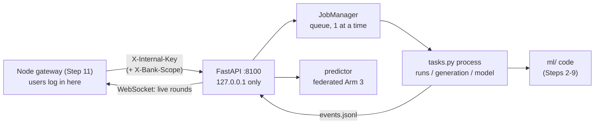

# Step 10: FastAPI Orchestration Service (Tier 3, Phase 5)

## 1. Goal
Wrap the whole ML system in a **web API** so the Node gateway (Step 11) and the React dashboard (Step 12) can drive it without terminal commands. The service shows banks and validation reports, replays or regenerates synthetic data **without ever overwriting the experiment files**, starts any of the six arms over chosen seeds as **background jobs**, streams federated rounds **live over a WebSocket**, scores single transactions with the **federated Arm 3 model**, and exports a bank's validated synthetic data **only to that bank's own operator**, with an audit log.

## 2. Concepts explained simply
- **API / REST / endpoint:** a restaurant's **menu and waiter**. You can't walk into the kitchen (the ML code), but you can order from a fixed menu: `GET /banks` ("show me the banks"), `POST /runs` ("start a run"). Orders and answers are written in **JSON**.
- **Why FastAPI in Tier 3:** it's Python, like our ML code, so it can call that code directly. Node (Tier 2) handles users and the database; FastAPI handles the science.
- **async:** the waiter doesn't stand at the stove for 20 minutes. They take your order, hand it to the kitchen and serve other tables. FastAPI can wait on slow things without freezing.
- **Background job:** long work gets a **job ticket** (ID) straight away, and you check its status later. Each job runs as a **separate Python process**, so heavy training can't freeze or crash the API. Only one runs at a time, because two trainings on one laptop just slow each other down.
- **WebSocket:** an open phone line. Instead of the dashboard asking "any news?" every second, the server **pushes** each federated round as it finishes.
- **Pydantic validation:** every request is checked against a declared shape. A transaction with a negative amount, or with columns missing, is rejected (HTTP 422) before our code runs.
- **Internal key:** the API listens only on this laptop (`127.0.0.1`) and requires a secret header that only the gateway knows. Users never see it; they log in at the gateway (Step 11).
- **Replay vs regenerate:** *replay* rebuilds the synthetic data deterministically (CTGAN retrained with its original seed, LLM rows rebuilt from the cached responses with **0 API calls**, the same gate) into a separate folder, then **compares checksums** with the files the experiments used. *Regenerate* creates genuinely new data in a new versioned folder (`generations/v1`, `v2`, …). Neither touches the experiment files.

## 3. What we built
| File | What it does |
|---|---|
| `configs/orchestrator.yaml` | Host/port (127.0.0.1:8100), job/audit folders, one job at a time, predict-model path, generations sub-folder |
| `services/orchestrator/settings.py` | Loads config and the internal key from `.env`; refuses to start without a key of ≥ 16 characters |
| `services/orchestrator/schemas.py` | Pydantic shapes: `Transaction` (Time, V1–V28, Amount), `Prediction`, `RunRequest`, `GenerationRequest`, `Job` |
| `services/orchestrator/jobs.py` | `JobManager`: queue + worker thread, one subprocess per job, status saved to `results/api_jobs/<id>/job.json`, cancel, recovery after restart |
| `services/orchestrator/tasks.py` | The work itself: `run` (any arms × seeds; a full report when all six run over ≥ 2 seeds), `generate` (replay/regenerate + gate + checksum comparison), `prepare_model`, `selftest` |
| `services/orchestrator/predictor.py` | Loads the saved federated model + threshold; scores transactions |
| `services/orchestrator/app.py` | All endpoints (table below) |
| `services/orchestrator/__main__.py` | `python -m services.orchestrator` starts the server |
| Changes in `ml/` | Optional output folders for CTGAN, LLM and the gate; `arms.run(seed, arms=…)` for a subset; the report builder takes a folder; the FL server can stream round events and save its final model. Defaults unchanged: the Step 9 report rebuilds byte-identically. |
| `tests/test_orchestrator_api.py` | 14 tests: key required (5 endpoints), aggregates-only `/banks`, results, request validation, prediction, export scoping + audit, job + WebSocket stream, WebSocket wrong key |

**Endpoints** (all need `X-Internal-Key` except `/health`; interactive docs at `http://127.0.0.1:8100/docs`):
| Method & path | Purpose |
|---|---|
| `GET /health` | Service up? Model present? Job counts |
| `GET /banks` | Per bank: mode, rows, fraud, training fraud, synthetic candidates/validated, pass rate, fidelity (aggregates only) |
| `GET /validation`, `GET /validation/{bank}` | Step 6 validation summary / full report |
| `GET /results/six-arms`, `GET /results/six-arms/convergence` | Step 9 tables (mean ± std, paired CIs) / per-round curves for every seed |
| `POST /runs` | `{arms: [1-6] or "all", seeds: [...]}` → job |
| `POST /generation` | `{banks: [...], mode: "replay" or "regenerate"}` → job |
| `POST /admin/prepare-model`, `POST /admin/selftest` | Build the `/predict` model; check the job system |
| `GET /jobs`, `GET /jobs/{id}`, `DELETE /jobs/{id}`, `GET /jobs/{id}/log`, `GET /jobs/{id}/events` | Job list, status, cancel, log, events |
| `WS /ws/jobs/{id}` | Live events (one per FL round), status changes, then `end` |
| `POST /predict`, `GET /predict/examples` | Score one transaction / one fraud + one genuine example from the global test set |
| `GET /banks/{bank}/synthetic/export` | That bank's validated synthetic CSV, only if `X-Bank-Scope` = that bank (set by the gateway); audited |



## 4. How to run it
```powershell
.venv\Scripts\activate
# once: ORCHESTRATOR_INTERNAL_KEY must be set in .env (already generated for you)
python -m services.orchestrator                 # API on http://127.0.0.1:8100 ; docs at /docs
# first time only (other window or /docs): POST /admin/prepare-model  -> builds models/predict_arm3_seed42.pt
pytest tests/test_orchestrator_api.py -q
```

## 5. Evidence (real output, 2026-10-11)
Full transcript of live requests: `results/api_demo/evidence.md`. Job folders: `results/api_jobs/`. WebSocket capture: `results/api_demo/ws_prepare_model_stream.jsonl`.

- **Auth:** `/health` without key → 200; `/banks` without key → **401**; with key → per-bank aggregates (e.g. bank_a: 69,546 rows, 149 fraud, 868 validated, 86.8% pass, fidelity 0.8041).
- **prepare_model job:** federated Arm 3, seed 42, 30 rounds → threshold logit 3.75, global F1 0.7955, PR-AUC 0.7261, **identical to Step 9 seed 42**. Model saved as `models/predict_arm3_seed42.pt` (git-ignored; its metadata JSON is committed).
- **WebSocket:** 30 live `round` events (global PR-AUC 0.7060 → 0.7261, banks A–D each round), then `succeeded` and `end`.
- **/predict:**
  | Example (true label) | Score (logit) | Probability | Flagged? |
  |---|---|---|---|
  | Fraud (1) | 8.5424 | 0.9998 | **yes** (≥ 3.75) |
  | Genuine (0) | −4.4133 | 0.0120 | no |

  A malformed transaction → **422**; `POST /runs {"arms":[7]}` → **422**.
- **Generation replay (all four banks):** every candidates and validated file **identical** to the experiment files (A 110.9 s, B 99.2 s, C 10.3 s, D 10.2 s); LLM banks made **0 API calls** (25 cached batches each). Outputs stayed inside each bank's folder (`data/clients/bank_x/generations/replay_…`, git-ignored).
- **Run job (Arm 3, seed 43):** **identical** to Step 9's seed-43 result; 30 round events streamed.
- **Export:** Bank C's operator → Bank B's data: **403**. Bank B's operator: 200, 814 rows, all synthetic fraud. Both attempts are in `results/api_audit/exports.log`.
- **Tests:** **70 passed** (14 new).

## 6. Explain it to the guide (script)
"Sir, in Step 10 I built the FastAPI service, the third tier of our architecture, so the dashboard can control everything without the terminal. It offers a menu of endpoints: the banks' status, validation reports, the six-arm results, starting any arm with chosen seeds, regenerating synthetic data, and scoring a single transaction. Long jobs like training run as separate background processes, so the API never freezes, and each federated round is pushed live over a WebSocket; I watched all 30 rounds arrive. For prediction I used the federated model, which scores a real fraud example at 99.98% and a genuine one at 1%. Replaying the synthetic generation reproduced all four banks' files byte for byte, with zero calls to the LLM API, and a run started through the API gave exactly the same result as our Step 9 experiment. For privacy, a bank's synthetic data can be exported only by that bank's own operator; any other bank gets 'forbidden', and every attempt is logged. The API only listens on this laptop and needs a secret key that only the gateway will know."

## 7. Likely viva questions
1. **Why run jobs in separate processes?** Training uses all CPU cores for minutes. A separate process can't freeze or crash the API, and jobs run one at a time so they don't slow each other down.
2. **How does the dashboard see live training?** The federated server writes one event per round to a file; the API pushes each new event to the dashboard over a WebSocket, an open connection, instead of the dashboard polling.
3. **Can the API overwrite the data our results came from?** No. Replay writes to a separate folder and only compares checksums; regeneration goes to a new versioned folder. The replay showed byte-identical files.
4. **How is privacy kept for "dataset export"?** Only validated synthetic rows (never real ones), only for one bank, and only when the gateway confirms the user is that bank's operator. Every attempt is audit-logged. This resolves a conflict between the requirements list and our privacy invariant, which we disclose (D-045).
5. **Which model answers /predict, and why?** The federated Arm 3 model (seed 42, 30 rounds). It's the privacy-preserving model, and Step 9 showed augmentation added no measurable benefit, so it's the best-evidenced choice.

## 8. Limitations and honest notes
- **Authentication is minimal here by design:** one shared internal key and a localhost-only listener. User accounts, passwords and roles (including the bank scope used by export) are enforced in the gateway (Step 11). Until then, `X-Bank-Scope` is trusted as sent.
- **`/predict/examples` returns two real transactions from the global test set**, which the experimenter (server side) holds, not any bank. Disclosed design choice for the demo.
- **The predicted "probability" is not calibrated** (D-010/D-028). Decisions use the logit threshold; the probability is shown for readability only.
- **One job at a time:** a 6-arm × 5-seed run (~22 min) blocks the queue. Cancellation stops the process but may leave partial files in the job folder.
- **Regeneration for LLM banks depends on the Groq free tier** (a daily token cap, Step 5) and isn't exercised in this step's evidence. Only replay was run.
- **Job folders accumulate** under `results/api_jobs/` (no automatic clean-up yet).
- **No HTTPS:** fine for localhost; the gateway–API link must stay on the same machine.

## 9. Next step
**Step 11: Node.js + Express gateway with MongoDB (Tier 2).** Users log in (JWT, with roles such as admin and per-bank operators that set `X-Bank-Scope`); the gateway forwards requests to this API with the internal key, relays the WebSocket, and stores runs, rounds, client metadata and validation reports in MongoDB. Milestone: a full run triggered and persisted through the API alone.
