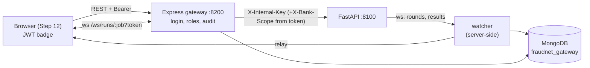

# Step 11: Node.js + Express Gateway with MongoDB (Tier 2, Phase 5)

## 1. Goal
Build the **front door** of FraudNet-Synth. People log in here with their own account and role. The gateway decides what each role may do, forwards allowed requests to the FastAPI orchestrator (Tier 3) with the secret internal key, and **records history in MongoDB**: every run, every federated round, every model's final metrics, the banks' metadata, validation reports and an audit trail. **Milestone:** a full six-arm run triggered and persisted **through the API alone**. Achieved: 60 rounds and 12 model results stored, identical to Step 9.

## 2. Concepts explained simply
- **Gateway:** a bank branch's front desk. It checks your ID, records what you did in the ledger, and passes your request to the back office (FastAPI), which customers never enter.
- **Node.js / Express:** JavaScript running on the server; Express is a small framework for web routes. We use Express 5, which also catches errors from `async` code automatically.
- **JWT (JSON Web Token):** a signed "visitor badge" issued at login, containing your username, role and bank. It's sent with every request (`Authorization: Bearer …`) and expires after 8 hours. Changing the badge (e.g. turning "viewer" into "admin") breaks its signature, so the gateway rejects it.
- **bcrypt password hashing:** passwords are stored as one-way scrambles, deliberately slow to compute (cost 12), so stolen hashes are very hard to reverse. Even we can't read the passwords back.
- **RBAC (role-based access control):** what each badge allows:
  | Role | Who | May |
  |---|---|---|
  | `admin` | Shubham | everything: start runs, generation, model preparation; cancel; read the audit log |
  | `bank_operator` | `bank_a` Shubham, `bank_b` Prachi, `bank_c` Pradeepa, `bank_d` Sathvik | view everything; **export only their own bank's** validated synthetic data |
  | `viewer` | `guide` (Dr. Chethan L S) | view everything, change nothing |
- **MongoDB (document database):** stores flexible JSON "documents" in "collections" (like tables). **Mongoose** adds schemas: field types, required fields, allowed values and indexes.
- **Watcher and relay:** for every job it starts, the gateway itself listens to FastAPI's live stream and **saves each round to MongoDB even if no browser is open**. It also relays the same events to any browser watching `ws://…/ws/runs/<job>`.
- **Audit log:** a record of who logged in, who tried something they weren't allowed to do, who started which run, and every export attempt.

## 3. What we built
| File | What it does |
|---|---|
| `services/gateway/package.json`, `package-lock.json` | Pinned dependencies: express 5.3.0, mongoose 9.11.1, jsonwebtoken 9.0.3, bcryptjs 3.0.3, ws 8.22.0, dotenv 18.0.7, helmet 8.3.0, express-rate-limit 8.7.1 (`npm audit`: 0 vulnerabilities); dev: supertest 7.3.1 |
| `src/config.js` | Reads `.env`: own database `fraudnet_gateway`, orchestrator URL + internal key, JWT secret (≥ 32 characters), 8 h token lifetime |
| `src/models.js` | Mongoose schemas and indexes (below); `audit()` helper |
| `src/auth.js` | `login` (bcrypt compare, generic error, audited), `requireAuth` (Bearer JWT), `requireRole` (audited 403) |
| `src/orchestrator.js` | `orch()`: calls FastAPI with `X-Internal-Key`; 502 if FastAPI is down |
| `src/watcher.js` | Server-side job watcher (persists rounds/model results/status in order, de-duplicates, reconnects, resumes after a restart) + live relay to browsers |
| `src/app.js` | Routes and role rules; export sets `X-Bank-Scope` **from the token**; browser WebSocket `/ws/runs/:jobId?token=…` with catch-up from MongoDB |
| `src/server.js`, `src/seed.js` | Start (127.0.0.1:8200; resumes watchers); create the 6 demo accounts from `.env` passwords |
| `scripts/e2e_milestone.js` | The milestone check: full run through the API, live watch as the guide, read-back from MongoDB, role checks |
| `test/gateway.test.js` | 9 tests against a fake orchestrator and a test database (below) |

### MongoDB schema design (database `fraudnet_gateway`)
| Collection | One document per | Key fields | Indexes / rules |
|---|---|---|---|
| `users` | account | username, displayName, role, bank, passwordHash, lastLoginAt | unique username; role ∈ {admin, bank_operator, viewer}; bank required **only** for operators |
| `runs` | job started via the gateway | jobId, type, params, status, requestedBy, startedAt, finishedAt, result, roundsReceived | unique jobId; by createdAt, status |
| `rounds` | federated round | jobId, arm, seed, round, globalTestPrAuc, globalTestRocAuc, banks[{bank, trainLoss, numExamples, uploadBytes}] | **unique (jobId, arm, seed, round)**, so a reconnect can't duplicate rounds |
| `modelresults` | trained model in a run | jobId, seed, arm, model, precision, recall, f1, prAuc | unique (jobId, seed, arm, model) |
| `banks` | bank (client metadata) | mode, rows, fraud, trainFraud, syntheticCandidates/Validated, passRatePct, fidelityValidated, syncedAt | unique bank |
| `validationreports` | bank | latest Step 6 report, syncedAt | unique bank |
| `auditevents` | security-relevant action | user, role, action, target, allowed, detail, time | by time |

**Design choices:** rounds live in their own collection rather than inside the run document, because a six-arm × 5-seed run has 300 rounds and documents should stay small and queryable. Results are stored *by reference* (`jobId`) to Tier 3's job. **No transaction rows (real or synthetic) are stored in MongoDB**, only metrics and metadata.



## 4. How to run it
```powershell
# Terminal 1: Tier 3
.venv\Scripts\activate
python -m services.orchestrator
# Terminal 2: Tier 2
cd services\gateway
npm install            # once
npm run seed           # once: creates the 6 accounts (passwords from .env)
npm start              # http://127.0.0.1:8200
npm test               # 9 tests (uses database fraudnet_gateway_test)
node scripts\e2e_milestone.js 42   # milestone check (~6 min)
```
**Demo passwords** are in `.env` as `GATEWAY_PW_ADMIN`, `GATEWAY_PW_BANK_A` … `GATEWAY_PW_GUIDE` (randomly generated). Give each teammate only their own.

## 5. Evidence (real output, 2026-10-11)
**Tests:** `npm test` → **9 passed**:
1. health is open, everything else needs a login, and a forged token is refused;
2. a wrong password gets the same message whether or not the user exists, and is audited;
3. passwords are stored only as bcrypt hashes (`$2b$12$…`);
4. banks are proxied with the internal key and synced to MongoDB;
5. a viewer or bank operator starting a run gets **403**;
6. an admin run is persisted and watched, a duplicate round is stored once, and the model result and final status are stored;
7. the browser WebSocket replays stored rounds and rejects a missing token (401);
8. export is allowed only for the user's own bank, the scope comes from the token (a spoofed `X-Bank-Scope` is ignored), and admin and viewer are refused;
9. the audit log is admin-only.

Python suite: **70 passed** (unchanged).

**Milestone** (`results/gateway_demo/e2e_milestone_output.txt`, real FastAPI + real MongoDB):
```
[   2s] viewer tries to start a run -> 403
[   2s] admin starts ALL SIX arms, seed 42 -> 202, job 20261011-173646-run-ea31eb, requestedBy admin
[   8s] message: seed 42: training arm1_isolated_real, arm2_isolated_aug, arm5_central_real, arm6_central_aug
[ 200s] model done: arm1_isolated_real   bank_d      F1 0.4063  PR-AUC 0.6861      (… 10 non-federated models)
[ 231s] live round  1 arm3_federated_real: global PR-AUC 0.7060 (banks ABCD)
[ 279s] live round 30 arm3_federated_real: global PR-AUC 0.7261 (banks ABCD)
[ 357s] live round 30 arm4_federated_aug: global PR-AUC 0.7231 (banks ABCD)
[ 361s] end: succeeded
[ 361s] MongoDB runs: status succeeded, requestedBy admin, roundsReceived 60, started 12:06:46Z, finished 12:12:45Z
[ 361s] MongoDB rounds: 60 documents (arm3_federated_real: 30, arm4_federated_aug: 30); live stream delivered 60
[ 361s] MongoDB modelresults: 12 models; live stream delivered 12
[ 361s] collection sizes: {"users":6,"runs":1,"rounds":60,"modelresults":12,"banks":4,"validationreports":4,"auditevents":5}
[ 361s] bank_b exports bank_b -> 200 ;  bank_b exports bank_c -> 403 ;  guide reads audit log -> 403
[ 362s] guide predicts the fraud example -> is_fraud true, logit 8.5424 (threshold 3.75)
```
- All **12 stored model results are identical to Step 9 seed 42 at full precision** (checked field by field).
- **Audit trail** (`results/gateway_demo/audit_events_snapshot.json`): 3 logins, the guide's forbidden `POST /api/runs`, admin's `start:run`, Bank B's allowed export of bank_b, Bank B's refused export of bank_c, and the guide's forbidden `GET /api/audit`.

## 6. Explain it to the guide (script)
"Sir, in Step 11 I built the gateway, our second tier, in Node.js with Express and MongoDB. Everyone now logs in with their own account. You have a viewer account that can see everything but change nothing, each teammate is the operator of one bank, and I'm the admin. Passwords are stored only as bcrypt hashes, and after login the gateway issues a signed token that says who you are and what you may do. The gateway checks that role on every request, adds the secret key, and forwards the request to the FastAPI service, which is never exposed directly. While a run is going, the gateway listens to it and stores every round and every model's result in MongoDB, even if nobody has a browser open. As the milestone, I started a full six-arm run through the API alone: all 60 federated rounds and 12 model results were stored, identical to our Step 9 numbers. Security rules are visible in the audit log: your account was refused when it tried to start a run, and Bank B's operator could export only Bank B's synthetic data."

## 7. Likely viva questions
1. **Why a separate gateway instead of calling FastAPI from the browser?** Separation of concerns: user accounts, roles, history and auditing live in Tier 2. Tier 3 stays a private service on localhost with one internal key, so the ML engine is never exposed.
2. **How are passwords protected?** Only bcrypt hashes (cost 12) are stored. Login errors don't reveal whether a username exists, and attempts are rate-limited (20 per 15 minutes) and audited.
3. **How does a bank operator's export stay restricted to their own bank?** The bank comes from their signed token, not from anything they send. The gateway refuses other banks (403) and sets `X-Bank-Scope` itself, and FastAPI checks it again. A test proves a spoofed header is ignored.
4. **Why store rounds in a separate collection?** A full multi-seed run has hundreds of rounds. Separate small documents with a unique (job, arm, seed, round) index are easy to query, can't be duplicated on reconnect, and keep run documents small.
5. **What if nobody watches a run in the browser?** The gateway's own watcher records everything regardless, and it resumes watching unfinished runs after a restart.

## 8. Limitations and honest notes
- **An earlier prototype's data was found** in MongoDB database `fraudnet_synth`: 7 `runs` from 2026-08-03 with different field names, plus collections `round_metrics`, `client_metrics` and `validation_reports`. As you chose, the gateway now uses its own database `fraudnet_gateway`, and the old data is untouched. A first milestone run had already written a few documents into `fraudnet_synth` (6 users, 1 run, 60 rounds, 12 model results, audit events). They are still there; delete them only if you want to.
- **The JWT is passed as `?token=` on the WebSocket** because browsers can't add headers to WebSockets. On localhost this is acceptable; on a real deployment it should be a short-lived ticket.
- **No HTTPS:** fine on one laptop; required for any real network deployment.
- **Tokens can't be revoked before they expire** (8 h); changing a role takes effect at the next login.
- **Demo accounts are seeded from `.env`;** there's no user-management page (out of scope).
- **The gateway trusts the orchestrator's job results** (both run on the same machine under our control).

## 9. Next step
**Step 12: React dashboard (Tier 1).** Login; bank mode indicators (Augment / Schema); a synthetic quality panel; live round charts from `/ws/runs/:job`; the six-arm comparison grid (highlighting fraud-class F1, precision and recall, not accuracy); a "test a transaction" form; run history; and dataset export for bank operators.
