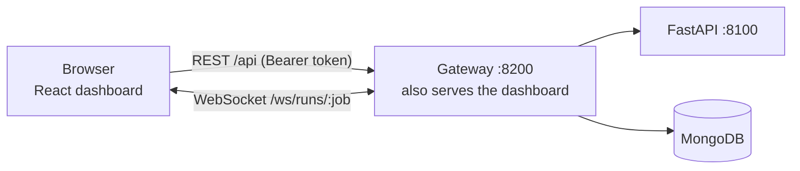

# Step 12: React Dashboard (Tier 1, Phase 6)

## 1. Goal
Make the whole system visible and usable in a browser. After logging in, each person sees only what their role allows:
- the four banks and their generation mode (Augment / Schema), with the synthetic quality panel;
- the six-arm comparison grid, highlighting fraud-class F1, precision and recall, not accuracy;
- **live charts of federated rounds** as they happen;
- run history;
- a "test a transaction" form;
- dataset export (bank operators, own bank only);
- the audit log (admin).

The dashboard talks only to the gateway (Tier 2), which enforces the same rules on the server.

## 2. Concepts explained simply
- **React and components:** a screen is built from reusable pieces, like Lego. `<ModeBadge>` and the bank card are written once and used for all four banks.
- **State:** what a component remembers, e.g. "the rounds received so far". When state changes, React redraws only what changed, so the live chart grows by one point per round without reloading the page.
- **Single-page app:** the page loads once, and the tabs swap views instantly.
- **Vite (build tool):** turns our source files into a few optimised files for the browser (`npm run build`). The gateway serves those files at the same address as the API, so the demo is **one URL, works offline, and needs no extra server**.
- **Recharts:** charts written as React components (`<LineChart>`, `<BarChart>`). Live data simply updates state and the chart redraws.
- **Role-aware UI:** the menu shows only the pages your role may use, but the **real protection is in the gateway**. Hiding a button is convenience; the server still refuses.
- **Dataviz rules we followed:** one validated colour palette (real = blue, augmented = aqua, banks A–D = fixed colours), a legend for every multi-series chart, hover tooltips, thin lines, no chart with two y-axes, status shown with an **icon plus a word** (not colour alone), headline metrics in bold and accuracy greyed out. Light and dark themes follow the computer's setting.

## 3. What we built
| File | What it does |
|---|---|
| `frontend/package.json`, `package-lock.json` | Pinned: react 19.3.0, react-dom 19.3.0, recharts 3.10.1, react-is 19.3.0; dev: vite 8.3.4, @vitejs/plugin-react 6.1.2 (`npm audit`: 0 vulnerabilities) |
| `frontend/vite.config.js` | Dev server on :5173 forwarding `/api` and `/ws` to the gateway; production build to `dist/` |
| `src/api.js` | Login/logout, token in memory + sessionStorage, `api()` with automatic logout on 401, authenticated download, WebSocket URL |
| `src/live.js` | `useRunStream(jobId)`: the gateway WebSocket (catch-up from MongoDB, then live), de-duplicated rounds, model results |
| `src/theme.js` | Validated palette (light/dark), fixed colour roles |
| `src/components.jsx` | Status badges (icon + label), mode badges, legends, tooltips, fetch helper, formatters |
| `src/styles.css` | Design tokens (light/dark), layout, tables, forms |
| `src/pages/Login.jsx` | Sign-in form |
| `src/pages/Overview.jsx` | Bank cards (mode, rows, frauds, training frauds, synthetic passed, pass rate, fidelity), pass-rate chart, rejection-reasons table |
| `src/pages/Results.jsx` | Six-arm table (headline bold, ROC-AUC/accuracy grey), F1 and PR-AUC bars with std error bars, convergence chart with ± std bands, paired-comparison table with a family filter |
| `src/pages/Runs.jsx` | Admin start panel (arms 1–6, seeds, replay generation), run history (auto-refresh), live run view (PR-AUC per round, per-bank training loss, upload size, finished models) |
| `src/pages/Predict.jsx` | Load a fraud/genuine example or type values, then a verdict with score, threshold and true label |
| `src/pages/ExportAudit.jsx` | Export (bank operators: own bank only) and audit log (admin) |
| `services/gateway/src/app.js` (changed) | Serves `frontend/dist`, with a fallback to the app for page routes; unknown `/api` routes return 404 |
| `services/gateway/scripts/ui_check.js` | Drives a real headless Microsoft Edge through every page as three roles, starts a live run from the UI, saves screenshots, reports browser errors |

| Page | admin | bank operator | viewer (guide) |
|---|---|---|---|
| Overview, Six-arm results, Runs (watch), Test a transaction | ✓ | ✓ | ✓ |
| Start runs / replay generation | ✓ | — | — |
| Export own bank's synthetic data | — | ✓ | — |
| Audit log | ✓ | — | — |



## 4. How to run it
```powershell
# Terminal 1: FastAPI
.venv\Scripts\activate
python -m services.orchestrator
# Terminal 2: gateway (serves the dashboard)
cd frontend; npm install; npm run build; cd ..     # once, or after UI changes
cd services\gateway; npm start
# open http://127.0.0.1:8200 and sign in (passwords: .env GATEWAY_PW_*)
# optional browser check (~70 s):  node scripts\ui_check.js
```
For UI development: `cd frontend; npm run dev` → http://127.0.0.1:5173 (with the gateway running).

## 5. Evidence (real output, 2026-10-11)
Browser check: `results/dashboard_demo/ui_check_output.txt`. Screenshots: `results/dashboard_demo/*.png`.
```
browser: Edg/155.0.4283.45
logged in as guide; tabs: Overview | Six-arm results | Runs (live) | Test a transaction
guide sees "Start a run"? false
logged in as admin; tabs: Overview | Six-arm results | Runs (live) | Test a transaction | Audit log
run started from the UI: 20261011-191512-run-eef150
mid-run rounds visible: 9
history row of this run: run 3 · 44 admin ✓ Succeeded 30
finished run shows: Latest: round 30 of Arm 3 · federated, real, seed 44 → global PR-AUC 0.7116
prediction: ⚠ Flagged as fraud
logged in as bank_b; tabs: Overview | Six-arm results | Runs (live) | Test a transaction | Export
bank_b export page: You are the operator of Bank B. Its validated synthetic pool has 814 fraud rows.
browser console: no errors or exceptions
```
- **A run started from the dashboard reproduces Step 9:** an earlier identical UI-started run (Arm 3, seed 44, job `20261011-191340-run-d4f15d`) was **identical to Step 9's seed-44 result in every round** and in the global test metrics (round-30 PR-AUC 0.7116).
- **Screenshots:**
  | File | Shows |
  |---|---|
  | `01_overview_guide.png` | Bank cards with mode badges, pass-rate chart, rejection reasons |
  | `02_six_arm_results.png` (dark) and `02b_six_arm_results_light.png` (light) | Six-arm table, bars with error bars, convergence, paired CIs |
  | `03_live_run_in_progress.png` | Live chart at round 9, status "Running" |
  | `04_live_run_finished.png` | 30 rounds, ✓ Succeeded, per-bank loss, finished model F1 0.7914 / PR-AUC 0.7116 |
  | `05_predict_fraud_example.png` | Fraud example flagged (score 8.54 ≥ threshold 3.75, "model correct") |
  | `06_audit_log_admin.png` | Audit log |
  | `07_export_bank_b.png` | Bank B's export page |
- **Build:** `vite build` → 655 KB JavaScript (191 KB gzipped) + 5 KB CSS. Gateway tests: 9 passed; Python tests: 70 passed.

## 6. Explain it to the guide (script)
"Sir, in Step 12 I built the React dashboard, the first tier, and it's served by our gateway at one address, so the demo runs offline on this laptop. When you log in as the guide you see four read-only pages: the four banks with their generation modes, the six-arm results, the runs, and a page to test a transaction. The results grid puts fraud-class precision, recall, F1 and PR-AUC in bold, while accuracy is greyed out because every model scores about 99.9% on this data. When I log in as admin, I can start a run from the browser and watch each federated round arrive live on the chart, along with each bank's training loss and the fact that only 17 kilobytes of weights travel per round. A run I started from the dashboard reproduced our Step 9 result exactly. On the test page, a real fraud example is flagged with a score above the threshold. Each teammate's bank account can download only their own bank's synthetic data, and everything is recorded in the audit log."

## 7. Likely viva questions
1. **Why does the dashboard never call FastAPI directly?** The gateway is the single entry point that checks logins and roles and keeps history. FastAPI stays private on localhost with its internal key.
2. **If a viewer edits the page to show the "Start run" button, can they start a run?** No. Hiding the button is only convenience; the gateway checks the role on every request and returns 403 (tested in Step 11).
3. **How do live charts work?** The browser opens a WebSocket to the gateway. The gateway first replays the rounds already stored in MongoDB, then forwards each new round as FastAPI reports it, and React adds a point to the chart.
4. **Why is accuracy greyed out?** 99.83% of test transactions are genuine, so every model reaches about 99.9% accuracy. Fraud-class F1, precision, recall and PR-AUC are the meaningful measures.
5. **Where is the login token kept?** In memory and in the tab's sessionStorage: it survives a refresh but disappears when the tab closes, and it expires after 8 hours.

## 8. Limitations and honest notes
- **Browser testing is automated with headless Edge** via the DevTools protocol (`ui_check.js`), not a full test framework. It checks the main flows, roles, a live run and console errors, but not every interaction.
- **Charts are drawn by Recharts in SVG.** The data tables on the same pages are the accessible alternative; there are no screen-reader-specific chart descriptions beyond titles and legends.
- **Run history refreshes every 4 s** (and immediately when a watched run ends); it isn't pushed live.
- **The token is visible in the WebSocket URL** (`?token=`), acceptable on localhost (D-049).
- **The build output (`frontend/dist`) is not committed** and must be rebuilt with `npm run build` after UI changes (and on a fresh machine).
- **The JavaScript bundle is 655 KB** (mostly Recharts/React). That's fine locally; it could be split for a real deployment.
- **The UI check started three extra Arm 3 / seed 44 runs** (`results/api_jobs/20261011-1911…`, `…1913…`, `…1915…`), all recorded in MongoDB. They're demo runs, not new results.

## 9. Next step
**Step 13: Integration and full evaluation.** Full-system runs triggered from the dashboard across all six arms (multi-seed), with the final results tables and plots for the report's results annexure copied from those real runs, and a check that they match the Step 9 command-line results.
