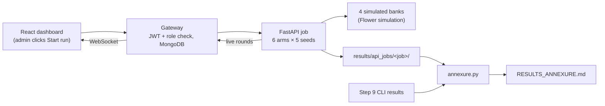

# Step 13: Integration and full evaluation (Phase 7)

## 1. Goal
Show that the four tiers work as one system, and produce the report's final results. The full experiment (all six arms × five seeds) was started **from the React dashboard** as the admin user. It flowed through the gateway (logged and stored in MongoDB) to FastAPI and the four simulated banks, and its results were compared with the command-line Step 9 run. The final tables and figures were then generated, by code, into a results annexure (`docs/RESULTS_ANNEXURE.md`) in which every number traces back to a saved run output.

## 2. Concepts explained simply
- **Integration (end-to-end) test:** testing all parts together, the way a real user would, after each part was tested on its own. *Analogy:* each part of a car passed its bench test; now we drive the assembled car on a real road.
- **Results annexure:** the appendix of the report with the final tables and figures.
- **Provenance:** for each table and figure, a record of the exact source file and its SHA-256 fingerprint, so an examiner can check that nothing was typed in by hand or changed later.
- **Reproducibility check:** the dashboard run was compared row by row with the command-line run. Same seeds and the same code should give *exactly* the same numbers, and they did.
- **Retake:** re-opening a finished run in the dashboard (its rounds are replayed from MongoDB) to capture a screenshot again. A retake is always labelled as one.

## 3. What we built
| File | Purpose |
|---|---|
| `services/gateway/scripts/full_run_ui.js` | Drives headless Edge: logs in as admin, ticks all 6 arms, enters seeds 42–46, starts the run, watches it live, and saves 4 screenshots + a log. `--reopen <job>` re-opens a finished run for a retake and **never** starts a run. Unknown arguments are refused. |
| `ml/evaluation/annexure.py` | Builds `docs/RESULTS_ANNEXURE.md` + `results/final_annexure/` (7 tables, 12 figures, `provenance.json`, `consistency.json`) from one dashboard job. Figures are copied byte-for-byte, and every caption number is computed. |
| `results/integration/` | Screenshots and logs of the dashboard runs, with a README explaining all three runs. |



## 4. How to run it
```powershell
# terminal 1 and 2: the services (dashboard must be built: cd frontend; npm run build)
.venv\Scripts\python -m services.orchestrator
cd services\gateway; npm start
# terminal 3: the full run from the dashboard (~15-30 min), then the annexure
cd services\gateway; node scripts\full_run_ui.js
cd ..\..; .venv\Scripts\python -m ml.evaluation.annexure
```
(A person can do the same by hand: log in as admin → Runs (live) → tick all six arms → seeds `42, 43, 44, 45, 46` → Start run.)

## 5. Evidence (real outputs, 2026-10-12)
**Main dashboard run `20261012-142636-run-eed13e`** (`results/integration/full_run_ui_output.txt`):
```
[    2s] arms ticked: 6 of 6; seeds: 42, 43, 44, 45, 46
[    3s] full run started FROM THE DASHBOARD: 20261012-142636-run-eed13e
[  156s] first federated arm on screen (30 round points)
[  203s] progress: 60 round points, 12 models finished
[  886s] progress: 300 round points, 60 models finished
[  888s] finished: 300 round points, 60 models
[  889s] browser console: no errors or exceptions
```
**MongoDB** (`fraudnet_gateway`): the run is stored as `succeeded`, requested by `admin`, with 300 round documents and 60 model results, plus the audit event `start:run`.

**Dashboard vs command line** (`results/final_annexure/consistency.json`): 180 vs 180 rows, 0 unmatched, max |difference| **0.0** on every metric, identical = **True**. The two earlier dashboard runs (`9d99cb`, `b5ac84`) are also identical (max difference 0.0).

**Headline results** (from the annexure, Table A4, global test, mean ± std over 5 seeds):

| Arm | F1 | PR-AUC |
|---|---|---|
| 3 · Federated, real | 0.7961 ± 0.0063 | 0.7158 ± 0.0061 |
| 4 · Federated, augmented | 0.7973 ± 0.0165 | 0.7171 ± 0.0067 |
| 5 · Centralized, real | 0.7748 ± 0.0275 | 0.7267 ± 0.0037 |
| 6 · Centralized, augmented | 0.7701 ± 0.0312 | 0.7250 ± 0.0061 |

The interpretation is unchanged from Step 9: federation clearly helps the data-poor banks; federated is close to centralized (PR-AUC −0.011); augmentation shows no reliable effect.

**Screenshots:** `results/integration/01_full_run_started.png`, `02_full_run_first_federated_rounds.png`, `03_full_run_midway.png`, `04_full_run_finished.png` (a labelled retake, see §8).
**Annexure:** `docs/RESULTS_ANNEXURE.md`, 7 tables + 12 figures, sources and checksums in `results/final_annexure/provenance.json`.

## 6. Explain it to the guide (script)
"Sir, in Step 13 I tested the whole system together. I logged into our dashboard as admin, ticked all six arms and five seeds, and pressed Start. The request went through our Node gateway, which checked my role and stored the run in MongoDB, then to the FastAPI service, which trained all the models while the dashboard showed every federated round live. The run took about 15 minutes, and MongoDB holds all 300 rounds and 60 model results. I then compared it row by row with the earlier command-line run, and all 180 result rows were exactly identical, which shows the full system is reproducible. Finally, a script builds the results annexure for our report directly from these saved outputs, so no number is typed by hand, and each table records which file it came from with a checksum. The conclusions are the same as before: federation helps the small banks a lot, federated is close to centralized, and synthetic data did not reliably help."

## 7. Likely viva questions
1. **How do you know the dashboard didn't change the results?** We compared all 180 metric rows of the dashboard run with the command-line run: the maximum difference was exactly 0.
2. **What path does a "Start run" click take?** Browser → gateway (JWT login, admin role check, stored in MongoDB, audited) → FastAPI job → Flower simulation of the four banks; live rounds come back over WebSockets.
3. **How can an examiner trust the annexure numbers?** They are generated by `ml/evaluation/annexure.py` from saved run files; `provenance.json` lists each source file with its SHA-256 checksum.
4. **Why did run times differ (15–29 min) if the results are identical?** Time depends on other load on the laptop; the computations and seeds are the same, so the outputs are the same.
5. **Is the "finished" screenshot live?** It is a labelled retake: the finished run was re-opened from history (rounds replayed from MongoDB). The live log shows the run finishing with 300 rounds and 60 models.

## 8. Limitations and honest notes
- **Evidence from an earlier session was not reproducible at first.** A first dashboard run (`b5ac84`) and an annexure already existed, but the driver script and the annexure generator had never been committed. Both were rewritten. The rewritten generator reproduced the old annexure's 7 tables and 11 of 12 figures exactly; the 12th differs only because its screenshot was retaken after that annexure was made.
- **A third full run was started by mistake** (`eed13e`): a failed edit left the script without `--reopen`, and it ran anyway and started a run. It overwrote screenshots 01–02 of run `9d99cb`. The run is valid and became the main evidence; the script now refuses unknown arguments. Details are in `results/integration/README.md`.
- **Screenshot 04 is a retake.** The live capture was taken ~2 s before the end event and showed "Running", because the finish check matched an older history row. The check now looks only at this run's own card.
- Some captures showed **squashed charts** because of a screenshot-tool resize; the capture now resizes first and waits. This was never a dashboard problem.
- Dashboard runs show the **same simulation** as Step 9 (one machine). The multi-laptop demo is Step 8B; its four-laptop test is still pending.
- The dashboard history also shows **four earlier test runs** (the Step 11 milestone run, all arms seed 42; three Step 12 browser checks, Arm 3 seed 44). They are demo runs, not new results.

## 9. Next step
**Step 14: testing, documentation and demo hardening.** It adds a full test overview (including API tests), a demo mode that needs no internet, and the final README, ARCHITECTURE document, a 5-minute demo script and a viva Q&A sheet compiled from all step files.
